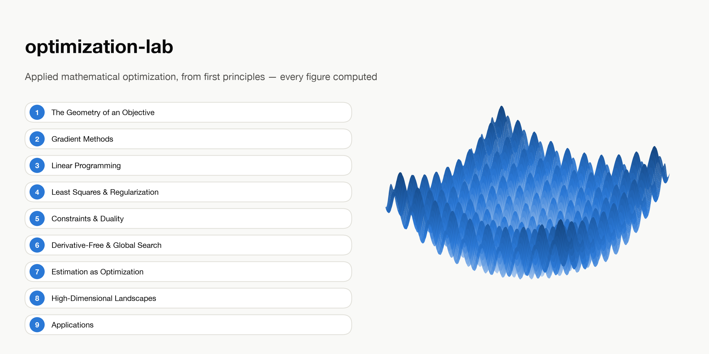

# optimization-lab



From-scratch implementations of core optimization algorithms, plus tooling for
comparing solvers, visualizing landscapes, and applying them to problems across
domains (physics, economics, machine learning).

- Docs site: **[ioannisantoniadis.github.io/optimization-lab](https://ioannisantoniadis.github.io/optimization-lab/)**
- Roadmap / current status: [`ROADMAP.md`](ROADMAP.md)


## Contents

A book in nine chapters on how optimization algorithms work and why, with every figure
and number computed at render time by the from-scratch implementations in this repo:

1. [The Geometry of an Objective](https://ioannisantoniadis.github.io/optimization-lab/chapters/01-the-geometry-of-an-objective.html) — slope, curvature, conditioning, the SVD, convexity
2. [Gradient Methods](https://ioannisantoniadis.github.io/optimization-lab/chapters/02-gradient-methods.html) — gradient descent, line search, momentum, Adam, Newton, BFGS, conjugate gradient
3. [Linear Programming](https://ioannisantoniadis.github.io/optimization-lab/chapters/03-linear-programming.html) — vertices and the simplex method
4. [Least Squares and Regularization](https://ioannisantoniadis.github.io/optimization-lab/chapters/04-least-squares-and-regularization.html) — the pseudoinverse, ridge, the lasso and proximal gradient, Gauss–Newton
5. [Constraints and Duality](https://ioannisantoniadis.github.io/optimization-lab/chapters/05-constraints-and-duality.html) — KKT, duality and shadow prices, the barrier method, ADMM, calculus of variations
6. [Derivative-Free and Global Search](https://ioannisantoniadis.github.io/optimization-lab/chapters/06-derivative-free-and-global-search.html) — Nelder–Mead, simulated annealing, genetic algorithms, particle swarm, Bayesian optimization
7. [Estimation as Optimization](https://ioannisantoniadis.github.io/optimization-lab/chapters/07-estimation-as-optimization.html) — MLE, MAP, Laplace, MCMC, EM
8. [High-Dimensional Landscapes](https://ioannisantoniadis.github.io/optimization-lab/chapters/08-high-dimensional-landscapes.html) — saddles, Hessian spectra, loss slices, mode connectivity, the NTK
9. [Applications](https://ioannisantoniadis.github.io/optimization-lab/chapters/09-applications.html) — imaging, system identification, control, ML, portfolios, fair allocation

The book's chapters follow the template in [`CONVENTIONS.md`](CONVENTIONS.md).

Plus, outside the docs site: a [solver arena](src/optimlab/arena.py) that runs every
solver against any problem and reports a standardized comparison, eight
[interactive marimo notebooks](#interactive-exploration-with-marimo) (one per phase)
for hands-on exploration in your own browser, and a
[wall-clock benchmark suite](#benchmarks) with real, warmed-up timings for every
solver.

## Quickstart

```bash
uv sync --extra viz --extra dev --extra docs   # install everything into .venv
uv run pytest                                  # run the test suite
```

[`uv`](https://docs.astral.sh/uv/) manages the Python environment; `uv run <cmd>` runs
a command inside it without activating a venv by hand. Add `--extra backends` for the
cvxpy-based correctness oracle (`optimlab.backends.cvxpy_backend`) — everything else,
including the scipy-based oracles, works without it.

## Repository layout

```
src/optimlab/
  core.py         Problem / OptimizeResult / Solver — the interface everything else uses
  arena.py        run_arena: register a Problem, get a standardized report (objective,
                  iterations, wall time, converged) across every solver in ALL_SOLVERS
  optimizers/     From-scratch solvers: gradient descent, momentum, Adam family, Newton,
                  BFGS/L-BFGS, line search, simplex (LP) + its Lagrangian dual, conjugate
                  gradient, Gauss-Newton (nonlinear least squares), projected/proximal
                  gradient (box constraints, LASSO), Nelder-Mead, simulated annealing,
                  genetic algorithm, particle swarm, Bayesian optimization (Gaussian
                  process + Expected Improvement) — all five gradient-free methods share
                  ALL_SOLVERS with the rest — barrier (interior point) method, ADMM
  linalg/         SVD / condition number, least squares (+ minimum-norm, rank-deficient),
                  ridge regression, equality-constrained least squares / QP
  landscapes/     Benchmark test functions (sphere, Rosenbrock, Rastrigin, ...) with
                  metadata (known minima, convexity, domain)
  inference/      MLE/MAP fitting, Laplace approximation, Metropolis-Hastings MCMC,
                  EM for Gaussian mixture models
  highdim/        A minimal MLP wrapped as a Problem, random-matrix saddle-point
                  statistics, Lanczos Hessian eigenspectrum, filter-normalized loss
                  landscapes, mode connectivity, neural tangent kernel concentration
  inverse/        Image deblurring (Tikhonov-regularized deconvolution), system
                  identification (nonlinear least squares on a simulated ODE)
  control/        LQR (Riccati recursion), nonlinear optimal control via direct
                  shooting, value iteration for a grid-world MDP
  ml/             Manual backpropagation (cross-checked against JAX autodiff),
                  physics-informed neural networks
  viz/            Plotly figure helpers: landscapes, solver-comparison plots, LP feasible
                  regions, regression fit/residuals, SVD conditioning, ridge/LASSO paths,
                  central path / KKT geometry / duality gap, posterior/MCMC/GMM figures,
                  saddle-point / Hessian-spectrum / loss-landscape / NTK figures,
                  deblurring / system-ID / control / grid-world / PINN figures,
                  solver-arena / efficient-frontier / fair-allocation figures
  backends/       Correctness-oracle adapters: scipy (core dep), cvxpy and optuna (need
                  the `backends` extra) for LP, least squares, QP, and black-box search
  problems/       Cross-domain problems: economics (Markowitz portfolio optimization /
                  efficient frontier), sociology/networks (fair resource allocation via
                  proportional fairness) — physics and ML live in optimizers/control
                  instead (Chapter 7's pendulum swing-up, Bayesian optimization)
docs/             Quarto site: theory + write-ups, with figures executed from real code
notebooks/marimo/ Interactive apps (see below)
benchmarks/       Wall-clock timing harness + generated results (see below)
tests/            Correctness/convergence tests for every solver
```

## Interactive exploration with marimo

[marimo](https://marimo.io) is a reactive Python notebook: cells re-run automatically
when their inputs change, and it has built-in UI widgets (sliders, dropdowns) that
trigger that re-run live in the browser. It's how this repo does hands-on
experimentation, as opposed to a static plot — the docs site's figures are executed
once at render time; these notebooks stay live in your own browser.

```bash
uv run marimo edit notebooks/marimo/gradient_descent_explorer.py
```

One entry point per phase, each picking that phase's most slider-worthy idea:

- **`gradient_descent_explorer.py`** (Phase 1) — pick a landscape and one or more
  solvers, drag the learning-rate / momentum / iteration-count sliders, watch the
  trajectory and convergence plots redraw live.
- **`lp_polytope_explorer.py`** (Phase 2) — drag a 2D LP's constraint bounds and
  objective weights; the feasible polytope and simplex's vertex path redraw live.
- **`regularization_path_explorer.py`** (Phase 3) — drag `alpha` and watch LASSO's
  coefficients hit exact zero while ridge's only approach it, on the same data.
- **`central_path_explorer.py`** (Phase 4) — drag two box-constraint bounds and watch
  the barrier method's central path curve toward the new constrained corner.
- **`bayesian_posterior_explorer.py`** (Phase 5) — drag trial/success counts and watch
  the true posterior, Laplace's Gaussian approximation, and an MCMC chain's samples
  agree or diverge.
- **`loss_landscape_explorer.py`** (Phase 6) — a trained network's filter-normalized
  loss-landscape slice and Hessian eigenspectrum, redrawn as you drag span, random
  direction, and Lanczos iteration count.
- **`control_explorer.py`** (Phase 7) — drag LQR's cost weights and initial state;
  the closed-form Riccati solve is instant, so every drag re-solves live.
- **`solver_arena_explorer.py`** (Phase 8) — pick a benchmark landscape and a starting
  point; every solver in `ALL_SOLVERS` runs against it and the ranked bar chart
  redraws live.

## Benchmarks

`benchmarks/BENCHMARKS.md` has actual wall-clock times for every solver, generated
(not hand-written) by `benchmarks/run_benchmarks.py`: the full solver arena (every
`ALL_SOLVERS` entry x every benchmark landscape), every other solver on its own
representative problem, and the `jit_f`/`jit_residual` opt-in flags on vs off. Every
number is a *median of several warmed-up repeats on a single reused `Problem`
instance*, not a single cold call — `Problem`'s JAX-compiled `grad`/`hess` (and
`jit_f`/`jit_residual`) are compiled lazily on first call and cached per-instance, so
an unwarmed timing mostly measures JIT tracing rather than steady-state solver cost.
Regenerate after changing a solver or adding a problem:

```bash
uv run python benchmarks/run_benchmarks.py
```

## Building the docs site

The site is a [Quarto](https://quarto.org) book that executes real `optimlab` code at
render time, so its figures come from the actual solvers, not hand-copied images.
Rendered outputs are cached in `docs/_freeze/` (`freeze: auto`): a chapter re-executes
only when its own `.qmd` changes, so after changing `src/optimlab/`, re-render the
affected chapters (or delete `docs/_freeze/` for a full re-execution) and commit the
refreshed `_freeze/`. The `Check frozen docs outputs` workflow re-executes every chapter on
`src/` changes and weekly, and fails if any computed text (printed output, tables, inline
numbers) no longer matches. This needs the [Quarto CLI](https://quarto.org/docs/get-started/)
installed separately (it isn't a Python package):

```bash
# One-time: register this project's venv as a Jupyter kernel, so Quarto executes
# code cells against it (with optimlab, jax, plotly available):
uv run python -m ipykernel install --user --name optimlab --display-name "optimlab (uv)"

quarto preview docs   # live-reloading local preview
quarto render docs    # one-shot build to docs/_site/
```

The docs page for the marimo app is a screenshot (`docs/images/`), not a live embed —
`optimlab` depends on JAX, which has no WebAssembly build, so the app can't run
client-side in a browser-only export. Regenerate the screenshot after changing that
notebook's UI: `uv run marimo edit notebooks/marimo/gradient_descent_explorer.py`,
screenshot it, save over `docs/images/gradient-descent-explorer-screenshot.jpg`.

## Sources

This project draws on standard optimization references and the primary literature
rather than following any single source — see `ROADMAP.md` for what's cited where, and
`docs/references.bib` for everything cited on the docs site.
