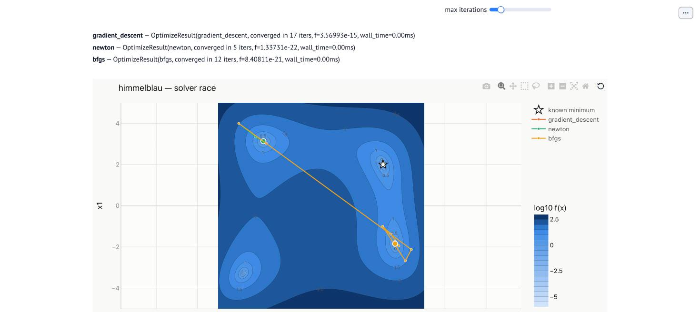

# Gradient Methods {#sec-gradient-methods}

@sec-geometry described the terrain: a slope at every point, a curvature that may be
very different in different directions, and a condition number that measures that
difference. This chapter is about walking downhill on it. Every method here follows the
same template: at the current point $x_k$, choose a direction $d_k$ and a step length
$\eta_k$, and move to
$$
x_{k+1} = x_k + \eta_k d_k .
$$
They differ in how much they measure before choosing: the gradient alone, the gradient
plus a memory of past gradients, a per-coordinate scale, or curvature, either exact or
estimated. Each extra piece of information fixes a specific weakness of the plain
gradient step, and the condition number $\kappa$ from @sec-geometry is the yardstick for
how much each one helps.

## The problem

Minimize a differentiable $f: \mathbb{R}^n \to \mathbb{R}$ with access to $f(x)$ and
$\nabla f(x)$, and for some methods $\nabla^2 f(x)$. Two costs matter: the number of
iterations, and the cost of one iteration. A gradient costs about as much as a few
evaluations of $f$ (with automatic differentiation). A Hessian has $n^2$ entries and
solving a linear system with it costs on the order of $n^3$ operations, which is
negligible for $n = 2$ and impossible for $n = 10^9$.

Most of the guarantees below assume the setting of @sec-geometry: $f$ is
**$L$-smooth** (Hessian eigenvalues at most $L$) and often **$\mu$-strongly convex**
(at least $\mu > 0$), with $\kappa = L/\mu$. On non-convex functions the same methods
still run, but they promise only to approach *a* stationary point.

## Gradient descent

The simplest choice of direction is the steepest one.

::: {.callout-note title="Definition — Gradient descent"}
$$
x_{k+1} = x_k - \eta\, \nabla f(x_k), \qquad \eta > 0 \text{ the step size (learning rate).}
$$
:::

### Why it works, and how large a step is safe

$L$-smoothness means the function can curve up no faster than a parabola with curvature
$L$, which gives an upper bound on $f$ around any point:
$$
f(y) \le f(x) + \nabla f(x)^\top (y - x) + \frac{L}{2}\lVert y - x \rVert^2 .
$$
Put $y = x - \eta \nabla f(x)$ into it:
$$
f\big(x - \eta \nabla f(x)\big) \le f(x) - \eta\left(1 - \frac{L\eta}{2}\right)
\lVert \nabla f(x) \rVert^2 .
$$
The bracket is positive whenever $\eta < 2/L$, so every such step decreases $f$ unless
the gradient is already zero. The decrease is largest at $\eta = 1/L$, where it equals
$\lVert \nabla f(x) \rVert^2 / (2L)$. Two classical rates follow
[@nocedal2006numerical; @boyd2004convex]:

- **convex** $f$, $\eta = 1/L$: $\; f(x_k) - f^\star \le \dfrac{L \lVert x_0 - x^\star \rVert^2}{2k}$;
- **$\mu$-strongly convex** $f$, $\eta = 2/(L+\mu)$:
  $\; \lVert x_k - x^\star \rVert \le \left(\dfrac{\kappa - 1}{\kappa + 1}\right)^{k} \lVert x_0 - x^\star \rVert$.

The second rate is the important one. A contraction factor of
$(\kappa-1)/(\kappa+1) \approx 1 - 2/\kappa$ per step means the number of iterations
needed to gain a fixed number of digits grows **in proportion to $\kappa$**.

### Watching it happen

On the quadratic $f(x) = \tfrac12(x_1^2 + 100\,x_2^2)$, with $L = 100$, $\mu = 1$ and
$\kappa = 100$, the step size has to stay below $2/L = 0.02$ to avoid blowing up along
the steep $x_2$ direction, and that same small step crawls along the shallow $x_1$
direction.

```{python}
#| label: ill-conditioned-setup
import numpy as np

from optimlab.core import Problem
from optimlab.optimizers import (
    adam, bfgs, conjugate_gradient, gradient_descent, heavy_ball, lbfgs, nesterov,
    newton_method,
)
from optimlab.viz import convergence_figure, markdown_table, race_figure, surface_race_figure

H = np.diag([1.0, 100.0])
L, mu = 100.0, 1.0
kappa = L / mu
x0 = np.array([10.0, 1.0])
tol = 1e-6

def quadratic(H=H):
    return Problem(f=lambda x: 0.5 * x @ H @ x, x0=x0.copy(), grad=lambda x: H @ x,
                   hess=lambda x: H, name="quadratic", minimum=np.zeros(2), f_min=0.0,
                   domain=(-11, 11))

gd = gradient_descent(quadratic(), lr=2 / (L + mu), max_iter=5000, tol=tol)
newton = newton_method(quadratic(), tol=tol)

rate_gd = (kappa - 1) / (kappa + 1)
g0 = np.linalg.norm(H @ x0)
predicted_gd = int(np.ceil(np.log(g0 / tol) / np.log(1 / rate_gd)))
```

```{python}
#| label: fig-ill-conditioned
#| fig-cap: "Gradient descent zig-zags across the narrow valley, because each step points mostly across it. Newton's method rescales each direction by its own curvature and reaches the minimum of this quadratic in a single step."
race = {"Gradient descent": gd, "Newton's method": newton}
fig = race_figure(quadratic(), race)
fig.update_layout(title="An ill-conditioned quadratic (κ = 100)")
fig.show()
```

Gradient descent needs `{python} gd.n_iter` iterations to bring the gradient norm below
$10^{-6}$. The contraction factor $(\kappa-1)/(\kappa+1)$ predicts
`{python} predicted_gd`: on a quadratic the rate is not just an upper bound but the
actual behavior. The same run, seen as a descent down the surface:

```{python}
#| label: fig-ill-conditioned-3d
#| fig-cap: "The same race in 3D. Gradient descent's path saws back and forth across the trough while it descends; Newton's method drops straight to the bottom. Drag to rotate."
surface_race_figure(quadratic(), race).show()
```

### Choosing the step: line search

A fixed step size needs $L$, which is rarely known, and a step that is safe in a steep
region is needlessly small in a flat one. A **line search** picks $\eta_k$ afresh at each
iteration by testing candidate steps along the chosen direction $d_k$.

::: {.callout-note title="Algorithm — Backtracking line search (Armijo)"}
Given a descent direction $d_k$ (one with $\nabla f(x_k)^\top d_k < 0$), a first guess
$\eta^{(0)}$, a shrink factor $\tau \in (0,1)$ and a constant $c_1 \in (0, 1)$, typically
$10^{-4}$:

1. Set $\eta \leftarrow \eta^{(0)}$.
2. While $f(x_k + \eta d_k) > f(x_k) + c_1\, \eta\, \nabla f(x_k)^\top d_k$, set
   $\eta \leftarrow \tau\eta$.
3. Return $\eta_k = \eta$.
:::

The test in step 2 is the **sufficient decrease** (Armijo) condition
[@armijo1966minimization]: the step must achieve at least a fraction $c_1$ of the
decrease that the linear model promises. It rejects steps that overshoot, and because
$d_k$ is a descent direction, a small enough step always passes, so the loop ends. Some
methods also need the **curvature** (Wolfe) condition
$\nabla f(x_k + \eta d_k)^\top d_k \ge c_2 \nabla f(x_k)^\top d_k$ with
$c_1 < c_2 < 1$, which rules out steps so short that the slope has barely changed
[@wolfe1969convergence]; quasi-Newton methods need it, as shown below.

On the Rosenbrock function, a curved valley whose curvature varies by orders of
magnitude along the way, the difference is stark:

```{python}
#| label: tbl-line-search
#| tbl-cap: "Gradient descent on Rosenbrock's function from (-1.2, 1) with a budget of 20,000 iterations. A fixed step large enough to make progress in the flat part of the valley overshoots in the steep part; a fixed step small enough to be safe never finishes. Backtracking from the larger step adapts to both."
from optimlab.landscapes import get

rosenbrock = get("rosenbrock")
start = np.array([-1.2, 1.0])
runs = {
    "fixed step 0.01": dict(lr=0.01),
    "fixed step 0.001": dict(lr=0.001),
    "backtracking, first guess 0.01": dict(lr=0.01, line_search=True),
}
rows = []
for label, kw in runs.items():
    r = gradient_descent(rosenbrock.problem(x0=start), max_iter=20000, **kw)
    outcome = ("diverged" if not np.isfinite(r.f) else
               "converged" if r.converged else "not converged")
    finite = np.isfinite(r.f)
    rows.append((label, outcome, r.n_iter if finite else "—", f"{r.f:.2g}" if finite else "—"))
markdown_table(["step-size rule", "outcome", "iterations", "final f"], rows, align="llrr")
```

[Implementation: [`optimizers/gradient_descent.py`](/optimizers/gradient_descent.py),
[`optimizers/line_search.py`](/optimizers/line_search.py) ·
Checked by: [`test_optimizers.py`](/test_optimizers.py)]{.impl}

## Momentum

Gradient descent zig-zags because consecutive gradients in a narrow valley point in
nearly opposite directions across it, while their small components *along* the valley
agree. Averaging recent gradients cancels the oscillating part and accumulates the
consistent part. That is momentum.

::: {.callout-note title="Definition — Heavy-ball momentum and Nesterov's method"}
**Heavy ball** [@polyak1964some]: keep a velocity $v_k$,
$$
v_{k+1} = \beta v_k - \eta \nabla f(x_k), \qquad x_{k+1} = x_k + v_{k+1}, \qquad 0 \le \beta < 1 .
$$
**Nesterov's accelerated gradient** [@nesterov1983method]: the same, but the gradient is
evaluated at the point the velocity is about to carry you to,
$$
v_{k+1} = \beta v_k - \eta \nabla f(x_k + \beta v_k), \qquad x_{k+1} = x_k + v_{k+1}.
$$
:::

Unrolling the recursion shows what momentum computes: $v_{k+1}$ is
$-\eta\sum_{j \le k} \beta^{k-j} \nabla f(x_j)$, an exponentially weighted sum of past
gradients with memory length about $1/(1-\beta)$. The physical picture is a heavy ball
rolling in the valley: friction ($1-\beta$) damps the sideways oscillation, and inertia
keeps it moving along the floor. Nesterov's version looks ahead before correcting, which
lets it brake earlier when the velocity is about to carry it uphill.

The payoff is a better dependence on conditioning. With well-chosen parameters, for
example $\beta = \big((\sqrt\kappa - 1)/(\sqrt\kappa + 1)\big)^2$ and
$\eta = 4/(\sqrt L + \sqrt\mu)^2$ for heavy ball on a quadratic, the contraction factor
improves from about $1 - 2/\kappa$ to about $1 - 2/\sqrt\kappa$: iteration counts grow
like $\sqrt\kappa$ instead of $\kappa$. Nesterov's method achieves the $\sqrt\kappa$
dependence on every smooth strongly convex function, not just quadratics, and no method
that only combines gradients can do better in general [@nesterov1983method]. For
$\kappa = 100$ that is the difference between hundreds of iterations and tens:

```{python}
#| label: momentum-runs
sqL, sqmu, sqk = np.sqrt(L), np.sqrt(mu), np.sqrt(kappa)
hb = heavy_ball(quadratic(), lr=4 / (sqL + sqmu) ** 2,
                beta=((sqk - 1) / (sqk + 1)) ** 2, max_iter=5000, tol=tol)
nag = nesterov(quadratic(), lr=1 / L, beta=(sqk - 1) / (sqk + 1), max_iter=5000, tol=tol)
```

```{python}
#| label: fig-momentum
#| fig-cap: "Objective value against iteration on the same κ = 100 quadratic (log scale). Momentum's averaging cancels the zig-zag, and both momentum methods reach the tolerance in a fraction of gradient descent's iterations. Heavy ball's curve is not monotone: a rolling ball overshoots the valley floor and swings back, so f rises for a few steps. Nesterov's look-ahead brakes early enough to avoid that here."
convergence_figure({"Gradient descent": gd, "Heavy ball": hb, "Nesterov": nag}).show()
```

Gradient descent needs `{python} gd.n_iter` iterations, heavy ball `{python} hb.n_iter`
and Nesterov's method `{python} nag.n_iter`: `{python} f"{gd.n_iter / hb.n_iter:.1f}"`
and `{python} f"{gd.n_iter / nag.n_iter:.1f}"` times fewer. The theory predicts a gap of
order $\sqrt{\kappa} = 10$. The measured factors are smaller because the rates are
asymptotic, and the constants in front of them differ from method to method.

Momentum has a cost: one more hyperparameter, and the non-monotone curves in
@fig-momentum. Set $\beta$ too high for the actual curvature and the ball overshoots
for a long time; the best values depend on $\mu$ and $L$, which are rarely known.

[Implementation: [`optimizers/momentum.py`](/optimizers/momentum.py) ·
Checked by: [`test_optimizers.py`](/test_optimizers.py)]{.impl}

## Adaptive step sizes: Adagrad, RMSProp and Adam

Momentum fixes the direction. Adaptive methods fix the scale, giving each coordinate its
own step size based on how large its gradients have been. Coordinates with
consistently large gradients get smaller steps; coordinates with small or rare gradients
get larger ones.

::: {.callout-note title="Definition — Adagrad, RMSProp and Adam"}
With $g_k = \nabla f(x_k)$ and all squares, square roots and divisions taken
coordinate by coordinate:

- **Adagrad** [@duchi2011adaptive]: $\; s_k = s_{k-1} + g_k^2, \quad
  x_{k+1} = x_k - \eta\, g_k / (\sqrt{s_k} + \epsilon)$.
- **RMSProp**: replace the growing sum with a moving average,
  $s_k = \rho\, s_{k-1} + (1-\rho)\, g_k^2$, so old gradients are forgotten.
- **Adam** [@kingma2015adam]: RMSProp's scale plus momentum's average,
  $$
  m_k = \beta_1 m_{k-1} + (1-\beta_1) g_k, \quad
  s_k = \beta_2 s_{k-1} + (1-\beta_2) g_k^2, \quad
  x_{k+1} = x_k - \eta\,\frac{\hat m_k}{\sqrt{\hat s_k} + \epsilon},
  $$
  where $\hat m_k = m_k/(1-\beta_1^k)$ and $\hat s_k = s_k/(1-\beta_2^k)$ correct the
  bias toward zero that comes from initializing $m_0 = s_0 = 0$. Typical values are
  $\beta_1 = 0.9$, $\beta_2 = 0.999$.
:::

Dividing by $\sqrt{s_k}$ makes the step in each coordinate roughly $\eta$ times the sign
of the (averaged) gradient, whatever the gradient's magnitude. This is a **diagonal
rescaling**: it treats each coordinate axis as having its own curvature. When the
ill-conditioning really is aligned with the axes, that is exactly the right correction.
When it is not, it isn't. Rotating the same quadratic by 45° changes nothing about its
difficulty for gradient descent, but it hides the bad direction from Adam:

```{python}
#| label: tbl-adam-rotation
#| tbl-cap: "Iterations to reach a gradient norm of 10⁻⁶ on the κ = 100 quadratic, aligned with the axes and rotated by 45°. Gradient descent does not care about the rotation; Adam's per-coordinate scaling helps only when the steep direction is a coordinate axis."
c, s = np.cos(np.pi / 4), np.sin(np.pi / 4)
R = np.array([[c, -s], [s, c]])
H_rot = R @ H @ R.T
rows = []
for label, M in [("aligned with the axes", H), ("rotated by 45°", H_rot)]:
    it_gd = gradient_descent(quadratic(M), lr=2 / (L + mu), max_iter=20000, tol=tol).n_iter
    it_adam = adam(quadratic(M), lr=0.1, max_iter=20000, tol=tol).n_iter
    rows.append((label, it_gd, it_adam))
markdown_table(["quadratic", "gradient descent", "Adam (η = 0.1)"], rows)
```

Adam and its relatives were designed for training neural networks on noisy gradients
from small batches of data, where the per-coordinate scale smooths the noise and adapts
to parameters that are updated rarely. On a clean, deterministic problem like the ones
in this chapter, they are rarely the fastest choice. They are not a substitute for
curvature information: a diagonal rescaling cannot see a valley that runs diagonally.

[Implementation: [`optimizers/adaptive.py`](/optimizers/adaptive.py) ·
Checked by: [`test_optimizers.py`](/test_optimizers.py)]{.impl}

## Newton's method

Gradient descent uses a linear model of $f$ and has to guess how far to trust it. Newton's
method uses the quadratic model from @sec-geometry and jumps straight to its minimum.

::: {.callout-note title="Definition — Newton's method"}
$$
x_{k+1} = x_k - \big[\nabla^2 f(x_k)\big]^{-1} \nabla f(x_k).
$$
In practice the step $p_k$ comes from solving the linear system
$\nabla^2 f(x_k)\, p_k = -\nabla f(x_k)$, never from forming the inverse.
:::

### Why it works

Minimize the second-order model $m(d) = f(x_k) + \nabla f(x_k)^\top d +
\tfrac12 d^\top \nabla^2 f(x_k)\, d$ over $d$: its gradient is
$\nabla f(x_k) + \nabla^2 f(x_k)\, d$, and setting that to zero gives exactly the Newton
step. In the eigenvector basis of the Hessian, the step divides the gradient's component
along each eigenvector by that direction's curvature $\lambda_i$: long steps where the
function is flat, short steps where it is steep. This removes the condition number from
the picture entirely, which is why @fig-ill-conditioned shows a single step: for a
quadratic, the model *is* the function.

For a general $f$, the reward is **quadratic convergence**. Near a minimum with a
positive definite Hessian, $\lVert x_{k+1} - x^\star \rVert \le C \lVert x_k - x^\star
\rVert^2$: the number of correct digits roughly doubles at every step
[@nocedal2006numerical, ch. 3].

### When it fails, and the fix

Newton's method solves $\nabla f = 0$, and @sec-geometry showed that saddles and maxima
satisfy that equation too. Where the Hessian has a negative eigenvalue, the quadratic
model has no minimum, and the Newton step heads toward the model's stationary point, which
can be uphill. Far from a minimum, even a positive definite model can be a poor guide and
the full step can overshoot. Two standard safeguards make it robust:

- **Damping the Hessian**: replace $\nabla^2 f(x_k)$ by a modified matrix whose
  eigenvalues are pushed up to at least some small positive value (or add a multiple of
  the identity, $\nabla^2 f + \lambda I$, the idea behind the Levenberg–Marquardt method
  of @sec-least-squares). The step is then always a descent direction.
- **A line search** on the Newton direction, accepting the full step $\eta = 1$ when it
  passes the Armijo test, which near the minimum it always does.

The price is the Hessian: $n^2$ second derivatives and an $O(n^3)$ linear solve per
iteration. That is why Newton's method dominates for small, smooth problems and is
unusable as-is for a neural network.

[Implementation: [`optimizers/newton.py`](/optimizers/newton.py) ·
Checked by: [`test_optimizers.py`](/test_optimizers.py)]{.impl}

## Quasi-Newton methods: BFGS and L-BFGS

Quasi-Newton methods get most of Newton's speed without ever computing a second
derivative. They build an approximation to the inverse Hessian from the gradients they
have already computed.

### The secant condition

Between two iterates, the change in gradient carries curvature information. With
$s_k = x_{k+1} - x_k$ and $y_k = \nabla f(x_{k+1}) - \nabla f(x_k)$, a first-order
expansion of the gradient gives $y_k \approx \nabla^2 f\, s_k$. Quasi-Newton methods
demand that the next Hessian approximation $B_{k+1}$ reproduce this exactly:
$$
B_{k+1}\, s_k = y_k \qquad \text{(the secant condition).}
$$
In one dimension this is the secant method's slope estimate. In $n$ dimensions it pins
down $B_{k+1}$ in only one direction, so methods differ in how they fill in the rest. BFGS
makes the smallest change to the previous approximation that satisfies the condition and
keeps it symmetric and positive definite.

::: {.callout-note title="Definition — BFGS"}
Keep $M_k \approx [\nabla^2 f(x_k)]^{-1}$. Step along $d_k = -M_k \nabla f(x_k)$ with a
Wolfe line search, then update
$$
M_{k+1} = \big(I - \rho_k s_k y_k^\top\big)\, M_k\, \big(I - \rho_k y_k s_k^\top\big)
+ \rho_k s_k s_k^\top, \qquad \rho_k = \frac{1}{y_k^\top s_k}.
$$
:::

The update keeps $M_{k+1}$ positive definite as long as $y_k^\top s_k > 0$, and the
Wolfe curvature condition guarantees exactly that. This is why the line search matters
here. Every BFGS direction is therefore a descent direction, and near a minimum the
approximation becomes accurate enough for **superlinear** convergence: faster than any
fixed contraction factor, though not quite Newton's digit-doubling
[@nocedal2006numerical, ch. 6]. The cost per iteration is $O(n^2)$ for the matrix
update, with no Hessian and no linear solve.

**L-BFGS** [@liu1989limited] removes the last obstacle to large problems: storing an
$n \times n$ matrix. It keeps only the last $m$ pairs $(s_k, y_k)$, typically 5 to 20, and
computes the product $M_k \nabla f(x_k)$ directly from them with a short two-loop
recursion. Memory and time per iteration drop to $O(mn)$, which makes it the default
choice for smooth deterministic problems with many variables.

```{python}
#| label: tbl-rosenbrock-methods
#| tbl-cap: "Iterations to converge on Rosenbrock's function from (-1.2, 1), and what each method computes per iteration. More information per step buys fewer steps: curvature, exact or estimated, cuts the count by more than two orders of magnitude."
methods = [
    ("Gradient descent + backtracking", "f, ∇f",
     gradient_descent(rosenbrock.problem(x0=start), lr=0.01, line_search=True, max_iter=20000)),
    ("L-BFGS", "f, ∇f, last m gradient pairs", lbfgs(rosenbrock.problem(x0=start))),
    ("BFGS", "f, ∇f, an n × n matrix", bfgs(rosenbrock.problem(x0=start))),
    ("Newton (damped)", "f, ∇f, ∇²f and a linear solve", newton_method(rosenbrock.problem(x0=start))),
]
markdown_table(
    ["method", "per iteration", "iterations"],
    [(name, info, r.n_iter if r.converged else f"> {r.n_iter}") for name, info, r in methods],
    align="llr",
)
```

[Implementation: [`optimizers/quasi_newton.py`](/optimizers/quasi_newton.py) ·
Checked by: [`test_optimizers.py`](/test_optimizers.py)]{.impl}

## Conjugate gradient

The minimum of the quadratic $f(x) = \tfrac12 x^\top A x - b^\top x$ with $A$ symmetric
positive definite is where $\nabla f = Ax - b = 0$. So minimizing a quadratic and
solving a linear system are the same problem, and the conjugate gradient method
[@hestenes1952methods] is the classic way to do both when $A$ is large: it needs only
products $Av$, never $A^{-1}$ and never a factorization.

### The idea: never undo earlier progress

Gradient descent's zig-zag means it keeps re-correcting directions it has already
handled. Conjugate gradient chooses search directions $p_0, p_1, \dots$ that are
**$A$-conjugate**, $p_i^\top A p_j = 0$ for $i \ne j$. Conjugate directions are
orthogonal in the geometry defined by $A$. In that geometry the ellipses of
@sec-geometry become circles, so an exact minimization along one conjugate direction is
never spoiled by a later one. After $n$ steps every direction has been handled once, and
the method lands exactly on the minimum.

::: {.callout-note title="Algorithm — Conjugate gradient for $Ax = b$"}
Start from $x_0$ with residual $r_0 = b - Ax_0$ and first direction $p_0 = r_0$. Then
for $k = 0, 1, \dots$:

1. Step length: $\eta_k = \dfrac{r_k^\top r_k}{p_k^\top A p_k}$ (the exact minimizer
   along $p_k$).
2. Move: $x_{k+1} = x_k + \eta_k p_k$, and update $r_{k+1} = r_k - \eta_k A p_k$.
3. Stop if $\lVert r_{k+1} \rVert$ is small enough.
4. New direction: $p_{k+1} = r_{k+1} + \beta_k p_k$ with
   $\beta_k = \dfrac{r_{k+1}^\top r_{k+1}}{r_k^\top r_k}$, which makes $p_{k+1}$
   conjugate to every earlier direction.
:::

The residual $r_k = b - Ax_k$ is the negative gradient, so the first step is a
gradient-descent step with an exact line search, and every later direction is the new
gradient corrected by a multiple of the previous direction, much like momentum with a
coefficient chosen exactly instead of tuned. In exact arithmetic CG terminates in at most
$n$ steps, and much sooner if the eigenvalues of $A$ come in a few clusters. In floating
point it is used as an iterative method, with an error that contracts like
$\big((\sqrt\kappa - 1)/(\sqrt\kappa + 1)\big)^k$, the same $\sqrt\kappa$ dependence as
the best momentum methods.

```{python}
#| label: fig-cg-vs-gd
#| fig-cap: "The κ = 100 quadratic posed as the linear system Ax = b. Conjugate gradient reaches the exact solution in two steps, one per dimension; gradient descent needs hundreds. Plotted as the residual norm ‖Ax − b‖ because this objective, ½xᵀAx − bᵀx, is negative near the solution and cannot be drawn on a log scale."
b = np.array([1.0, 100.0])  # solution x = (1, 1)
cg = conjugate_gradient(H, b, tol=1e-12)
gd_linear = gradient_descent(
    Problem(f=lambda x: 0.5 * x @ H @ x - b @ x, x0=np.zeros(2), grad=lambda x: H @ x - b),
    lr=2 / (L + mu), max_iter=1500,
)
convergence_figure({"Conjugate gradient": cg, "Gradient descent": gd_linear},
                   metric="grad_norm").show()
```

Nonlinear variants of CG (Fletcher–Reeves, Polak–Ribière) apply the same direction update
to general smooth functions, with a line search in place of the exact step length
[@nocedal2006numerical, ch. 5].

[Implementation: [`optimizers/conjugate_gradient.py`](/optimizers/conjugate_gradient.py) ·
Checked by: [`test_conjugate_gradient.py`](/test_conjugate_gradient.py)]{.impl}

## On a non-convex landscape

Everything above was stated for convex functions. On a non-convex one, the same methods
still decrease $f$ and still approach a stationary point, but which one they reach
depends on where they start and on the shape of each method's path. Himmelblau's function
from @sec-geometry has four minima of equal depth:

```{python}
#| label: fig-himmelblau-race
#| fig-cap: "Four methods started from the same corner of Himmelblau's function. Gradient descent, Nesterov's method and Newton's method all settle into the nearest minimum. BFGS's first steps, taken before its curvature estimate is any good, are long enough to carry it across the plain into a different minimum."
himmelblau = get("himmelblau")
corner = [-4.0, 4.0]
race = {
    "Gradient descent": gradient_descent(himmelblau.problem(x0=corner), lr=0.01, max_iter=200),
    "Nesterov": nesterov(himmelblau.problem(x0=corner), lr=0.005, beta=0.8, max_iter=200),
    "Newton's method": newton_method(himmelblau.problem(x0=corner)),
    "BFGS": bfgs(himmelblau.problem(x0=corner)),
}
fig = race_figure(himmelblau.problem(x0=corner), race)
fig.update_layout(title="Himmelblau's function: four methods, one start")
fig.show()
```

```{python}
#| label: fig-himmelblau-race-3d
#| fig-cap: "The same four runs on the 3D surface: four narrow wells in a shallow plain. Three paths drop into the nearest well; BFGS crosses the plain to another one."
surface_race_figure(himmelblau.problem(x0=corner), race).show()
```

```{python}
#| label: fig-himmelblau-convergence
#| fig-cap: "Objective value against iteration for the same four runs (log scale). Newton's method and BFGS converge in a handful of iterations. Dotted segments mark a method that has already converged, held at its final value for comparison."
convergence_figure(race).show()
```

No method here did anything wrong: each found a minimum. Which one it found depends on
the starting point and on the shape of the method's own early steps, not on any notion
of which minimum is best. When the minima differ in depth, that is a real problem, and it
is why @sec-derivative-free trades local efficiency for global exploration.

::: {.callout-tip title="Try it yourself"}
An interactive version of these figures (pick a landscape and a starting point, drag the
step size and momentum sliders, and watch the race redraw) runs locally as a
[marimo](https://marimo.io) notebook. See @sec-the-code for how to start it.


:::

## What these examples cannot show

- **Noise.** Training a model computes gradients on small random batches of data, so
  every gradient is a noisy estimate. Step-size rules, momentum and adaptive scaling all
  behave differently under noise, and line searches mostly stop working. Stochastic
  gradient methods are outside the scope of this book's examples.
- **Scale.** Iteration counts on two-dimensional problems hide the cost per iteration.
  Newton's method wins every table here and is unusable for $n = 10^6$; L-BFGS and
  first-order methods are what remain.
- **Tuning.** Every comparison above uses step sizes and momentum coefficients chosen
  with knowledge of $L$ and $\mu$. In practice they are tuned by trial and error, and a
  well-tuned simple method often beats a badly tuned sophisticated one.

## Connections

- **@sec-geometry** supplies the quantities every rate in this chapter depends on:
  $L$, $\mu$ and the condition number $\kappa$.
- **@sec-least-squares** applies the Newton idea to sums of squares (Gauss–Newton) and
  explains when an exact solution makes iteration unnecessary.
- **@sec-constraints** shows how Newton's method, applied to a sequence of smoothed
  problems, solves problems with inequality constraints.
- **@sec-high-dim** asks why these local methods work at all on neural-network losses,
  where the landscape is non-convex and has millions of dimensions.
