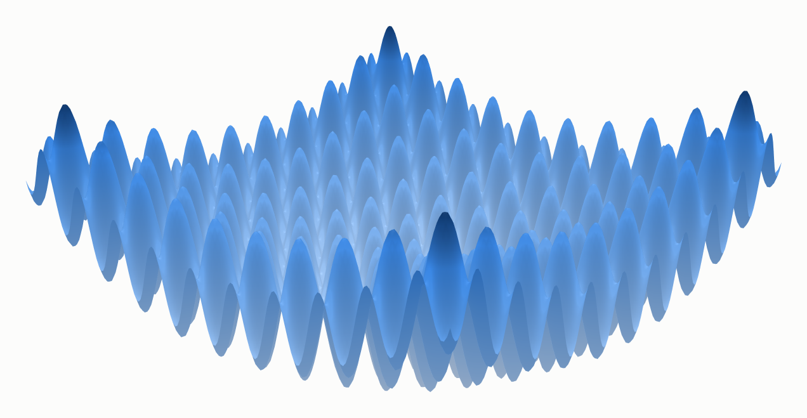

# Welcome {.unnumbered}

Optimization is the mathematics of choosing the best option: the parameters that fit
data best, the controls that steer a system most cheaply, the allocation that does the
most with a fixed budget. Almost every quantitative field relies on it, and most people
who use it meet it through a library call, a learning rate, a solver that converged or
did not. This book is about what happens inside that call: how the main families of
optimization algorithms work, why they work, what each assumes about the problem, and
how they fail.

Its organizing idea is that every method makes a bet about what is worth measuring. A
gradient method bets on the local slope; Newton's method on curvature; the simplex method
on the corners of a polyhedron; a barrier method on staying strictly inside the
constraints; a genetic algorithm on a population exploring in parallel; Bayesian
optimization on a statistical model of the objective. Each bet pays off on some problems
and fails on others, and the shape of the problem (its smoothness, its convexity, its
conditioning, its constraints, its dimension) decides which.

{#fig-hero}

Three commitments shape the book:

1. **Mechanism first.** Every method is presented with its update rule, the one
   derivation step that makes it work, the settings that matter, and the ways it fails,
   so that it can be understood without reading any code.
2. **Every figure is computed.** Each plot and each number on these pages is produced at
   build time by a from-scratch implementation of the method it illustrates, and checked
   against independent solvers where one exists. The code is folded away by default;
   *Show the code* above any figure reveals how it was made.
3. **Honest scope.** The examples are small enough to see. Each chapter ends by saying
   what its small examples cannot show.

## How this book is organized

[The map](chapters/00-map.qmd) shows the whole book on one page, with reading paths.
**Part I, Foundations**, describes the geometry of an objective (slope, curvature,
conditioning, convexity) and the gradient and curvature methods built on it.
**Part II, Convex workhorses**, covers linear programming, least squares and
regularization, and constraints and duality: the problem classes with exact answers
and strong guarantees. **Part III, Beyond convex and smooth**, drops those assumptions:
derivative-free and global search, estimation from data, and the high-dimensional
non-convex landscapes of neural networks. **Part IV** applies all of it to problems from
imaging, physics, control, machine learning, economics and resource allocation. The
appendices hold a guide to choosing an algorithm, the notation, a note on the code
behind the figures, and further reading.

## What you need

Multivariable calculus (gradients, the chain rule, Taylor expansions), linear algebra
(matrices, eigenvalues, orthogonality) and basic probability (Gaussian distributions,
expectations). No prior optimization is assumed.

## Related books

This book shares its conventions with companion books on related topics:
[loss functions](https://ioannisantoniadis.github.io/loss-functions-lab/) (where
objectives come from),
[reinforcement learning for language models](https://ioannisantoniadis.github.io/rl-for-llms/)
and [data for machine learning](https://ioannisantoniadis.github.io/data-lab/).
